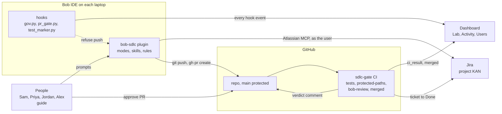

# Architecture

## The picture



## Stage map

| Stage | Bob feature | File in the repo | Control that enforces it |
|---|---|---|---|
| Pick work | skill `/tickets` ("check my tickets") | `.bob/plugins/bob-sdlc/skills/tickets/SKILL.md`, `mcp.json` | Jira permissions: the MCP server acts as the signed-in user |
| Plan | mode `SDLC Plan`, skill `/plan <KEY>` | `custom_modes.yaml` (`sdlc-plan`), `rules-sdlc-plan/plan-format.md` | Mode tool groups: edit only `plans/*.md`, no command tool |
| Approve | requester reply in chat | `plans/<KEY>.md` (`Requester approval: approved`) | PR gate item `plan-approved` |
| Build | mode `SDLC Build`, skill `/build <KEY>` | `custom_modes.yaml` (`sdlc-build`), `rules-sdlc-build/build-order.md`, `rules/*.md` | Rules in context; `gov.py` asks the dashboard on every prompt and tool call (package, secret, PII and git rules) |
| Test | pytest, marker hook | `.bob/hooks/test_marker.py` | PR gate item `tests-passed`; CI job `tests` |
| Push and PR | `gh pr create`, PR template | `.bob/hooks/pr_gate.py`, `governance/pr-checklist.yaml`, `.github/pull_request_template.md` | PR gate refuses the push in one sentence |
| Review | mode `SDLC Review`, skill `/review`, headless `bob run` | `.github/workflows/sdlc-gate.yml`, `skills/review/SKILL.md`, `rules-sdlc-review/review-output.md` | CI job `bob-review`, rules pinned to main, fails closed without a verdict |
| Protect the platform | rule `05-protected-paths.md` | `tools/ci/protected_paths.py`, `.github/CODEOWNERS` | CI job `protected-paths` |
| Merge | GitHub merge | `tools/ci/protect-main.sh` | Branch protection: tests, protected-paths, bob-review green, one approving review |
| Close and measure | CI job `merged` | `tools/ci/jira_transition.py`, `dashboard/` | Ticket to Done; dashboard Lab page |
| Change the rules | skill `/new-check` | `skills/new-check/SKILL.md` | Protected path, platform PR, owner review |

Hooks fail open. If the dashboard is down, Bob continues. CI and branch protection are the controls that hold. For enforced hooks and an MCP gateway, see [docs/enterprise](enterprise/README.md).

## The software-factory view

Uber describes AI coding as a software factory. The cost model is a product of six factors:

```
spend = users x sessions/user x turns/session x requests/turn x tokens/request x price/token
```

| Factory idea | In this lab |
|---|---|
| One managed agent per task | One mode per stage: `SDLC Plan`, `SDLC Build`, `SDLC Review`, each with its own tools |
| The reuse unit | Skills: `/tickets`, `/plan`, `/build`, `/review`, `/new-check` |
| Fewer turns per session | Skills carry the facts that save turns; narrow modes stop wandering |
| Outcome-denominated cost | The "Cost per merged PR" tile on the Lab page: usage credits divided by merged PRs |

Cost per token tells you what you bought. Cost per merged PR tells you what you got.
