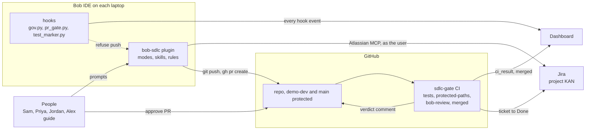

# Architecture

This page shows the parts of the lab and the control behind each stage.

## The parts



| Part | What it does |
|---|---|
| Bob plugin | Four modes, the skills and the rules. Each mode has only the tools its stage needs. |
| Hooks | Small scripts that Bob runs before and after each prompt and action. They block what the rules forbid and report to the dashboard. |
| Jira | Holds the tickets. Bob reads and changes them as the signed-in person, through MCP (a connector). |
| GitHub | Holds the code. Ticket pull requests go into `demo-dev`. CI checks every pull request. |
| Dashboard | Shows usage, violations, time to merge and the audit log. |

## Stages and their controls

| Stage | Bob feature | Files | Control |
|---|---|---|---|
| Pick work | Mode `SDLC Agent`, skill `tickets` | `skills/tickets/SKILL.md`, `mcp.json` | Jira permissions: Bob sees only what the signed-in person sees. |
| Plan | Mode `SDLC Plan`, skill `plan` | `custom_modes.yaml` (`sdlc-plan`), `rules-sdlc-plan/plan-format.md` | The mode can edit only `fieldops-repo/plans/*.md`. It has no command tool. |
| Approve | The requester comments `Approved` on the Jira ticket. Bob writes the approval line into the spec. | `fieldops-repo/plans/<KEY>.md` | PR gate item `plan-approved` |
| Build | Mode `SDLC Build`, skill `build` | `custom_modes.yaml` (`sdlc-build`), `rules-sdlc-build/build-order.md`, `rules/*.md` | `gov.py` checks every prompt and tool call: packages, secrets, personal data, git. |
| Test | pytest in `fieldops-repo/`, the test marker hook | `.bob/hooks/test_marker.py` | PR gate item `tests-passed`; CI job `tests` |
| Push and pull request | `gh pr create`, the PR template | `.bob/hooks/pr_gate.py`, `.bob/governance/pr-checklist.yaml`, `.github/pull_request_template.md` | The PR gate refuses the push and names the missing item in one sentence. |
| Review | Mode `SDLC Review`, skill `review`, headless `bob run` | `.github/workflows/sdlc-gate.yml`, `skills/review/SKILL.md`, `rules-sdlc-review/review-output.md` | CI job `bob-review`. The rules come from main. No verdict means fail. |
| Protect the platform | Rule `05-protected-paths.md` | `.github/scripts/protected_paths.py`, `.github/CODEOWNERS` | CI job `protected-paths` |
| Merge | GitHub merge | Branch protection | The checks are green and one person approves. |
| Close and measure | CI job `merged` | `.github/scripts/jira_transition.py` | The ticket moves to Done. The dashboard shows the merge. |
| Change the rules | Skill `new-check` | `skills/new-check/SKILL.md` | Protected path, platform pull request, owner review |

Hooks fail open: if the dashboard is down, Bob continues. CI and branch protection are the controls that hold.

## For maintainers

### Enterprise rollout

An admin can make the hooks mandatory with the `EnforcedHooks` group policy. An MCP gateway can sit in front of Jira. The facilitator covers both.

### Cost per merged pull request

One way to model AI coding spend:

```
spend = users x sessions/user x turns/session x requests/turn x tokens/request x price/token
```

| Idea | In this lab |
|---|---|
| One agent per task | One mode per stage, each with its own tools |
| Reuse | Skills: `tickets`, `plan`, `build`, `fix`, `review`, `new-check` |
| Fewer turns | Skills carry the facts that save turns. Narrow modes stop wandering. |
| Cost per outcome | The "Cost per merged PR" tile: usage credits divided by merged pull requests |

Cost per token tells you what you bought. Cost per merged pull request tells you what you got.
